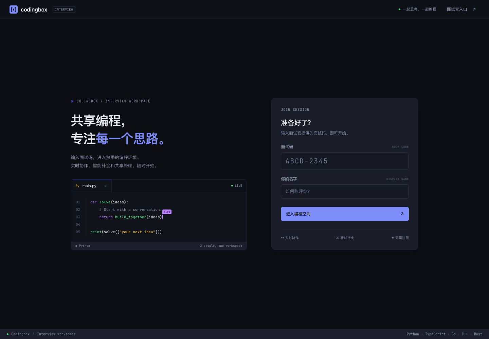
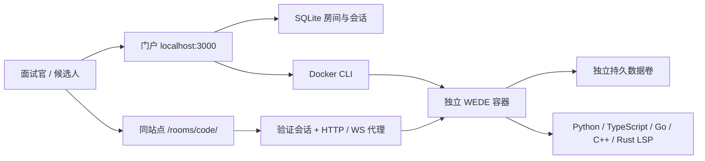

## TL;DR

Codingbox 是基于 WEDE 的轻量面试工具：输入面试码，进入共享编程空间。

## Details

| 功能 | 实现 |
| --- | --- |
| 面试官控制台 | 密码登录、创建、列表、结束、导出 |
| 面试记录 | 进行中 / 已完成页签；历史查询、分页、单条或批量下载和删除 |
| 候选人加入 | 面试码或直接房间链接，无需注册或再次登录 IDE |
| 在线编程 | WEDE 编辑器、共享光标、共享终端 |
| 语言服务 | Python / TypeScript / Go / C++ / Rust，预装编译器与语言服务器 |
| 一键运行 | 顶栏 ▶ Run，等待保存后在共享终端运行，支持 stdin 和退出码 |
| 房间聊天 | 所有语言共享消息；保留换行和缩进，加载历史时显示 Loading… |
| 面试内切换 | 共享语言选择；各语言保留独立项目，终端与 LSP 跟随切换 |
| 房间生命周期 | 每场独立容器、到期关闭、数据卷保留 |



## 本地启动

需要 Node.js 22.13+、npm、Docker Engine/Desktop，以及可用的 Docker daemon。建议 Node.js 24 LTS。

```sh
git clone --recurse-submodules https://github.com/DefeatMan/codingbox.git
cd codingbox
npm ci
npm run image:build
cp .env.example .env
```

编辑 `.env`，把 `ADMIN_PASSWORD` 改为至少 12 位的独立密码，然后运行：

```sh
npm start
```

打开 **http://localhost:3000**。使用 `localhost`，不要用 `127.0.0.1` 访问门户。

1. 点击「面试官入口」，输入 `.env` 中的密码。
2. 创建房间，等待状态变成「进行中」。
3. 将面试码或邀请链接发给候选人。
4. 双方填入自己的名字进入。例如 `ABCD-2345`。
5. 结束后，在控制台下载 `.tar.gz` 代码包。

创建时只需填写名称和有效时间，默认以 Python 开始；进入编辑器后双方可切换语言。已完成页签支持按名称或面试码查询，每页 10 条；「全选本页」不会选中其他页面。批量下载生成一个包含各场代码包和记录清单的 `.tar.gz` 文件。

删除需在对话框确认，会永久移除已完成面试的记录和对应代码数据。下载中的记录暂不能删除，删除失败会保留记录供重试；进行中的房间必须先结束。详见[面试记录设计](https://github.com/DefeatMan/codingbox/issues/4)。

浏览器会进入同一站点的 `/rooms/abcdefgh/`。有效的面试码就是入场凭据，也可直接分享该房间链接；无需通配 DNS 或为每个房间注册 tunnel。

## 架构



所有房间复用一个入口。门户按 `/rooms/{code}/` 分流 HTTP、WebSocket 和资源请求；浏览器存储按面试码区分，避免多标签页串房。编辑器端口只监听宿主机回环地址。本版不提供房间之间的浏览器 origin 隔离。

## 运行配置

| 变量 | 默认值 / 说明 |
| --- | --- |
| `PUBLIC_URL` | `http://localhost:3000`；公网设为 `https://app.boxlite.ai` |
| `HOST` / `PORT` | `127.0.0.1` / `3000` |
| `ADMIN_PASSWORD` | 必填，至少 12 位 |
| `DATA_DIR` | `.data`，保存 SQLite 和会话 |
| `WEDE_IMAGE` | `codingbox-wede:local` |
| `MAX_ACTIVE_ROOMS` | `5`；启动中或错误房间也占用名额，结束后释放 |
| `MAX_CONCURRENT_EXPORTS` | `2`；单条、批量导出共用，包含准备、等待下载和传输中的任务 |
| `ROOM_MEMORY` / `ROOM_CPUS` | 每场 `1g` / `1` CPU |

房间有效期为 15–480 分钟；界面提供 1、2、4、8 小时。服务每 15 秒清理过期实例，请求校验会立即拒绝过期访问。

重启门户会逐个恢复已有房间；单个实例失败时显示「恢复中」，每 15 秒重试，其他房间仍可使用。中断的创建流程会清理。结束操作立即撤销访问并关闭连接，等待正在进行的恢复后移除容器，保留卷。

导出仅包含 `project`，不包含门户数据库或 WEDE 登录配置。批量导出先在服务端准备，再由浏览器直接下载；准备完成的链接需管理员登录、只能使用一次，60 秒未使用自动清理。并发已满时返回 429，可稍后重试；下载取消或服务关闭会清理工作进程与临时文件。

## 部署到 app.boxlite.ai

参见 [部署说明](docs/deployment.md)，包含域名、TLS、反向代理和 systemd 配置。只需 `app.boxlite.ai` 指向主机，所有房间复用该域名。

## 验证

```sh
npm run check
npm test
# 需要 Go（版本见 third_party/wede/go.mod）及支持 race detector 的 C 编译器
npm run test:wede
npx playwright install chromium
# 在另一终端用 npm start 启动服务；使用同一份 .env
npm run test:e2e
```

集成测试覆盖访问控制、撤销、恢复与结束并发、导出限流和清理、日志脱敏。`test:wede` 在临时副本应用生产补丁，检查四个 Go 包的竞态；CI 在 Linux 执行。浏览器测试覆盖共享编辑、终端重启恢复、文档重连、LSP、五种语言运行和原生下载。

点击顶栏 **▶ Run** 运行当前所选语言的项目入口（如 Go 的 `go run .`），输出显示在房间共用的 Run 终端。再次运行会停止上次进程、清空输出，并从所选语言目录启动新的 Shell；手动终端保留。双方可输入 stdin、按 Ctrl+C 中断；刷新页面不会自动重新执行。每个项目最多 16 个手动终端。

聊天属于整个房间，切换语言或刷新后仍可查看。Enter 发送，Shift+Enter 换行；粘贴文本保留换行和缩进。历史消息先加载，Git 活动异步补充；断线重连期间保留已有消息，并显示加载状态。慢连接队列满时会断开并重连补齐历史。

终端默认在底部展开。终端列表由服务端管理，约每半秒检查更新；跨公网时还需加上网络延迟。编辑器进程重启后，手动终端接受新列表并清除旧的初始化命令。协作状态保存在项目的 `.wede/collab`，用于重连和进程恢复，避免纯文本重新初始化导致内容叠加。

## 代理开发工具

本仓库使用 [BoxLite Agent Tooling](https://github.com/boxlite-ai/agent-tooling) 提供 Git 审计和共享开发规范。代理开发前，在仓库根目录运行：

```sh
./.agent-tooling/install.sh
```

安装需要 Bash、Git、jq、Perl 和网络连接；会为当前工作区配置 Git hooks，并更新 `AGENTS.md` 与 `CLAUDE.md`。检查命令声明在 `.agent-tooling/profile.json`，审计运行数据仅保存在被忽略的本地目录。Codex 或 Claude 的插件启用步骤见[官方接入说明](https://github.com/boxlite-ai/agent-tooling#add-to-a-repository)。

`.agent-tooling/` 下的安装和启动脚本来自该项目，采用 Apache-2.0，许可文本见 [.agent-tooling/LICENSE](.agent-tooling/LICENSE)。

## 已知边界

- 这是单机实验版，容器提供基本隔离，不等同于微虚拟机。编辑器不挂载 Docker socket、主机目录或业务凭证。
- WEDE 的实时协作默认关闭，Codingbox 在加入时开启；避免手动关闭协作，否则会退回独立编辑。
- WEDE 暂不协调终端或 Git 对已打开文件的外部修改。通过编辑器修改代码，终端用于运行。
- 每场面试保留独立 Docker 卷，需定期备份、人工清理。参见部署说明。
- 运行中的 Docker 容器重启可能改变映射端口；此时需重新进入房间，让门户刷新代理目标。已有浏览器收到新服务端状态后会更新终端列表。
- 可选 Linux native 预览模式使用独立 Unix 用户和私有目录，资源上限由外层 Box 提供；它没有每房间容器。参见 [BoxLite 预览](docs/boxlite-preview.md)。
- 当前没有录像回放、评分、候选人账号或多人组织管理。

## 来源与设计

- [初始设计](https://github.com/DefeatMan/codingbox/issues/1) · [单入口设计](https://github.com/DefeatMan/codingbox/issues/2)
- [WEDE](https://github.com/vul-os/wede) 固定为 Git 子模块；镜像构建时应用 [兼容补丁](docker/patch-wede.mjs)，修正协作与 LSP 生命周期。子模块工作区保持原样。
- 与 WEDE 一致，采用 [MIT](LICENSE-MIT) OR [Apache-2.0](LICENSE-APACHE) 双许可证，可任选其一；保留 VulOS 和 Codingbox 的版权声明。第三方依赖及字体保留各自许可证，编辑器 `/licenses.txt` 可查看依赖声明，门户字体声明位于 `public/fonts/`。
